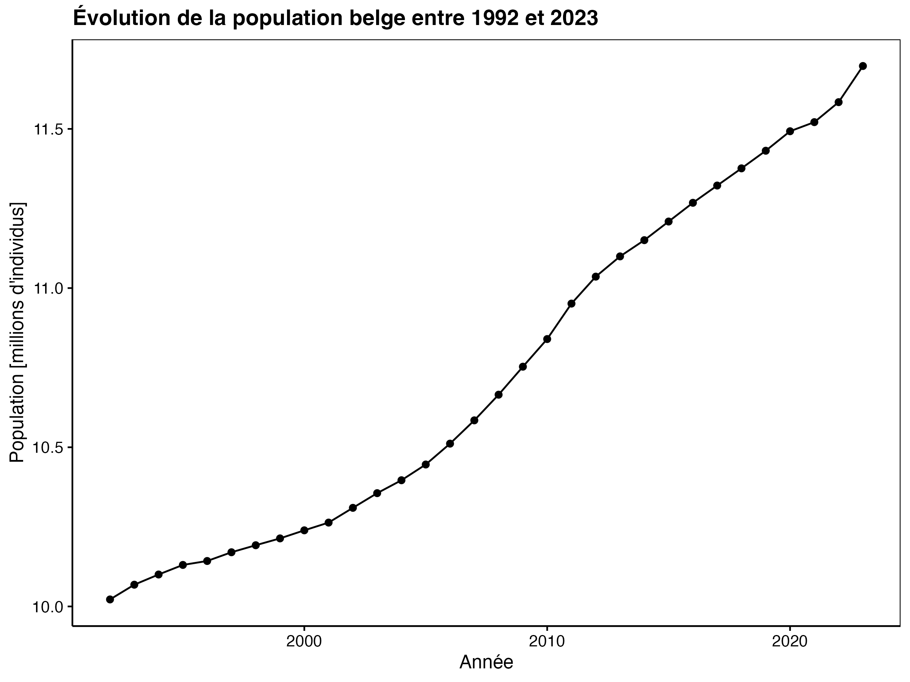
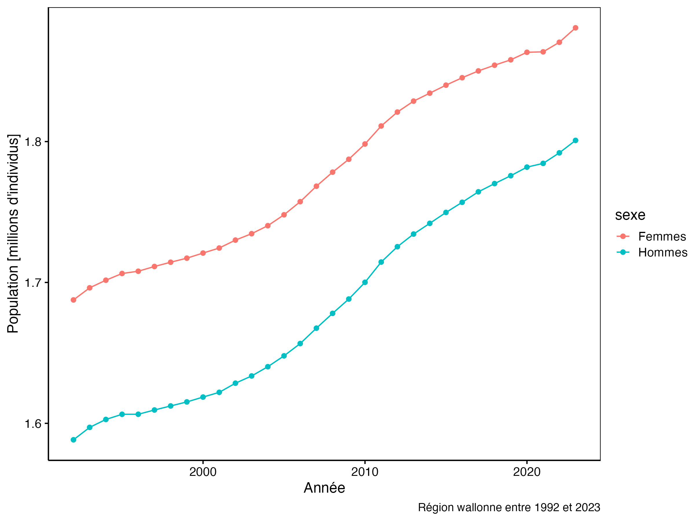
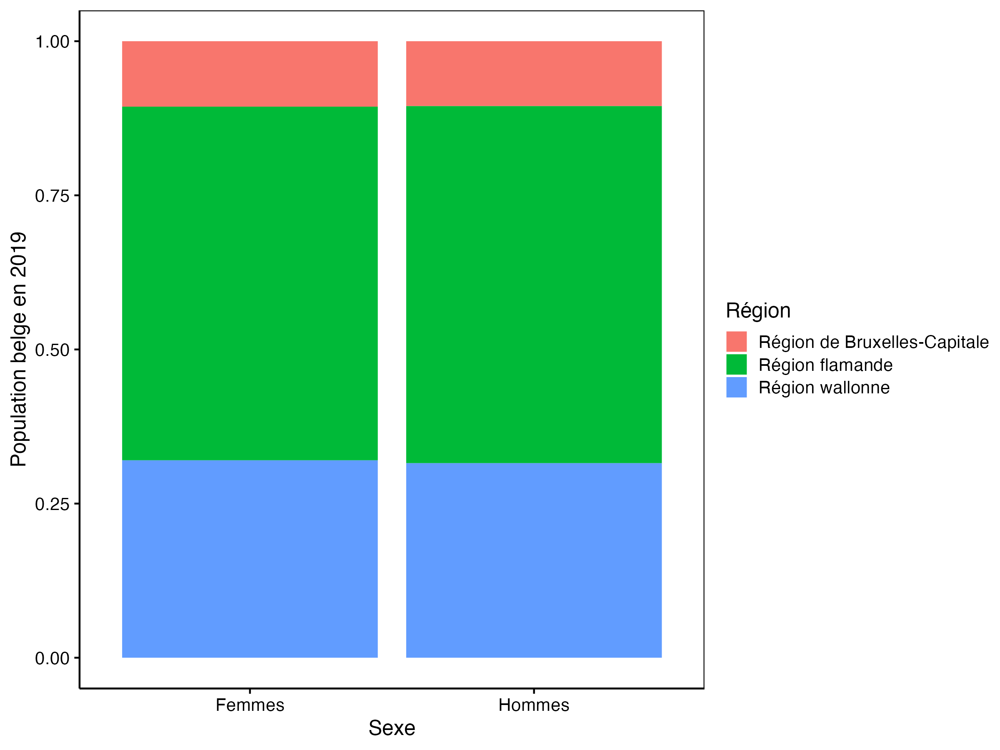

# Introduction et but

L'office belge de statistique Statbel (<https://statbel.fgov.be/fr/propos-de-statbel>) diffuse des données sur l'économie, la société et le territoire. Parmi ces données nous utiliserons celles relatives au recensement de la population dans les trois régions de Belgique. Notre objectif est de décrire la démographie de la population belge au fil des ans.

# Matériel et méthodes

Les données issues du site de Statbel ont été exportées le 3 décembre 2023. Les données brutes ont été en partie remaniées dans le cadre de cet exercice. Les valeurs de démographie par catégorie n'ont pas été modifiées.

L'analyse est réalisée dans la [SciViews Box `r rmarkdown::metadata$svbox`](https://www.sciviews.org/software/svbox/) dans [Saturn Cloud](https://saturncloud.io) (`r rmarkdown::metadata$vm`) avec le [logiciel R](https://www.r-project.org) (`r R.version.string`). Les packages {data.io} version `r packageVersion("data.io")`, {svTidy} version `r packageVersion("svTidy")` et {chart} version `r packageVersion("chart")` sont utilisés respectivement pour importer les données, les remanier et réaliser les graphiques.

```{r setup, include=FALSE}
# Ceci est nécessaire pour les tests SDD, ne pas utiliser dans un "vrai" projet
if (!"tools:tests" %in% search())
  source(here::here("tests/tools_tests.R"), attach(NULL, name = "tools:tests"))

# Configure Knitr pour utiliser AGG comme périphérique graphique
knitr::opts_chunk$set(dev = "ragg_png")

# Configuration de l'environnement SciViews::R
SciViews::R(lang = "fr")
```

## Déclaration sur l'utilisation de l'IA

<!--% Spécifiez si vous avez employé l'intelligence artificielle dans votre projet. -->

```{r ai_comment, output='asis'}
select_answer(r"-{
[] -   Ce document a été rédigé en étant assisté par l'Intelligence Artificielle.
[] -   Ce document a été rédigé sans recours à l'Intelligence Artificielle.}-")
```

<!-- Précisez ci-dessous l'utilisation que vous avez faite de l'IA. Citez le modèle utilisé. -->

# Analyses

## Remaniement des données

Nous importons, combinons et remanions les différents jeux de données.

<!--% Importez les trois tableaux relatifs à la population entre 1992 et 2009 en Région wallonne, en Région flamande et en Région Bruxelles-Capitale en utilisant la fonction read() du package {data.io}. Fusionnez ensuite ces trois tableaux en un seul dans `pop_92`. Note : l'argument encoding = "UTF-8" permet de donner le format d'encodage des variables caractères. -->

<!--# Avant chaque fusion de tableaux, vous devez avoir pris connaissance des variables des tableaux à combiner. Il est également important d’avoir une idée claire du tableau final souhaité. Cela vous permettra de choisir si la meilleure solution est l’empilement (bind_***_()) ou la fusion (***_join_()).-->

```{r pop92, record='RODFS', object='pop_92'}
# Région wallonne
rw_92 <- ___(___, encoding = "UTF-8")
# Région Flamande
rf_92 <- ___(___, encoding = "UTF-8")
# Région Bruxelles capitale
rb_92 <- ___
# Association des tableaux
pop_92 <- ___
```

<!--% Importez les trois tableaux relatifs à la population entre 2010 et 2023 en Région wallonne, en Région flamande et en Région Bruxelles-Capitale. Fusionnez ensuite ces trois tableaux en un seul dans `pop_10`. Note : l'argument encoding = "UTF-8" permet de donner le format d'encodage des variables caractères. -->

```{r pop10, record='RODFS', object='pop_10'}
# Région wallonne
rw_10 <-  ___(___, encoding = "UTF-8")
# Région Flamande
rf_10 <-  ___(___, encoding = "UTF-8")
# Région Bruxelles capitale
rb_10 <- ___
# Association des tableaux
pop_10 <- ___
```

<!--% Fusionnez les tableaux `pop_92` et `pop_10` pour en obtenir un seul nommé `pop`. Modifiez ce dernier en transformant toutes les variables débutant par "population" pour obtenir un tableau long avec, entre autres, une colonne `year` (année de la mesure) et une colonne `n` (nombre d'individus). À la fin de ces opérations, vous devriez avoir un tableau de 6 variables et 1152 lignes. -->

```{r join, record='RODFS', object='pop'}
# Fusion des deux tableaux
pop <- ___
# Conversion de large à long
pop <- ___
```

<!--# La première partie du code suivant est fournie. Il permet d'extraire la date d'une chaîne de caractères. Par exemple, il faut donc extraire 1992 de la chaîne de caractères suivante "population_au_01_janvier_1992". La fonction substr() est employée. Il y a plusieurs façons de faire. Nous aurions pu obtenir un résultat similaire avec la fonction separate_().  -->

<!--% Modifiez la variable `n` pour exprimer la population en millions d'individus. -->

```{r mutate, record='RODFS', object='pop'}
# Modification de la variable `year` pour la rendre numérique
pop <- mutate_(pop, year = ~ as.numeric(substr(pop$year, 26, 29)))
# Conversion de `n` en millions d'individus
pop <- ___
```

Les données retravaillées se présentent comme suit :

```{r datafinal, warning=FALSE}
tabularise$headtail(pop)
```

## Description des données

L'augmentation de la population belge entre 1992 et 2023 est représentée ci-dessous.



<!--% Reproduisez à l'identique le graphique ci-dessus. Ce graphique requiert d'obtenir une variable correspondant au nombre d'individus par année. Vous obtiendrez cette variable en calculant un tableau résumé. Nommez cette variable 'tot'. -->

```{r plot1, record='RNCS'}
pop %>.%
  ___ %>.%
  summarise_()  %>.%
  chart(., ___) + 
  ___() +
  ___() +
  labs(___)
```



<!--% Reproduisez à l'identique le graphique ci-dessus. Ce graphique requiert d'obtenir une variable de nombre d'individus par année et par sexe. Nommez cette variable 'tot'. Note : l'utilisation de .groups = "drop" permet de ne plus tenir compte des groupes pour la suite de l'analyse. -->

```{r plot2, record='RNCS'}
pop %>.%
  filter_(., ___) %>.%
  ___(., ___) %>.%
  summarise_(., ___ , .groups = "drop") %>.%
  chart(data = ., ___) +
  ___() +
  ___() +
  labs(___)
```

<!--% Interprétez ces deux graphiques. -->

```{r plot2comment, output='asis'}
select_answer(r"-{
[] -   La population totale en Belgique a augmenté de plus de 15 % en trois décennies.
[] -   La population totale en Belgique a augmenté de plus de 25 % en trois décennies.

[] -   Le nombre de femmes et d’hommes est similaire en Région wallonne.
[] -   Le nombre de femmes est plus élevé que le nombre d’hommes en Région wallonne.
[] -   Le nombre de femmes est plus faible que le nombre d’hommes en Région wallonne.

[] -   L’augmentation au cours du temps du nombre de femmes et d’hommes est similaire (courbes quasi parallèles).
[] -   L’augmentation au cours du temps du nombre de femmes est nettement plus lente que celle du nombre d’hommes.
[] -   L’augmentation au cours du temps du nombre de femmes est nettement plus rapide que celle du nombre d’hommes.}-")
```



<!--% Reproduisez à l'identique le graphique ci-dessus. Ce graphique requiert d'obtenir une variable de nombre d'individus par région et par sexe. Nommez cette variable 'tot'. Note : l'utilisation de la fonction ungroup_() permet de ne plus tenir compte des groupes pour la suite de l'analyse. -->

```{r plot3, record='RNCS'}
pop %>.%
  filter_(___) %>.%
  ___(___) %>.%
  summarise_(___)  %>.%
  ungroup_(.) %>.%
  chart(data = ., ___) +
  ___() +
  labs(___)
```

<!--% Décrivez le graphique en barres réalisé ci-dessus.-->

```{r plot3comment, output='asis'}
select_answer(r"-{
[] -   Ce graphique montre que le nombre total de femmes et d’hommes est similaire dans les différentes régions.
[] -   Ce graphique ne permet pas de déterminer si les hommes ou les femmes sont plus nombreux au total dans les différentes régions.

[] -   La région la plus peuplée est la Région flamande.
[] -   La région la plus peuplée est la Région wallonne.
[] -   La région la plus peuplée est la Région de Bruxelles-Capitale.

[] -   La répartition entre régions diffère entre hommes et femmes : la part des hommes est nettement plus élevée en Région flamande.
[] -   La répartition des femmes entre les trois régions est similaire à celle des hommes.
[] -   La répartition entre régions diffère entre hommes et femmes : la part des hommes est nettement plus élevée en Région wallonne.}-")
```
